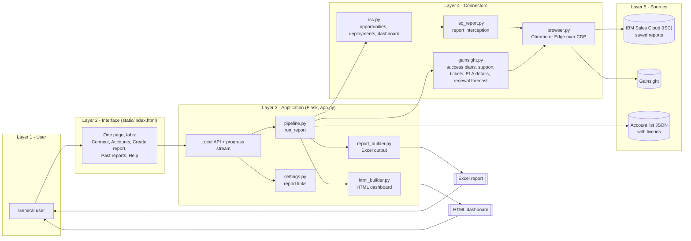

# Industry Market Account Health Report (V3)

One window, three steps, two files: an Excel workbook and an HTML dashboard.

1. **Connect**: click *Sign in to ISC*, sign in with your IBM ID, then click *Connect Gainsight*.
2. **Accounts**: nothing is pre-selected. Tick the accounts you want (or *Select all*). *Create report* stays disabled until you pick at least one.
3. **Create report**: pick the year, tick the sections to **Include** (Opportunities for the current and next quarter, with the renewals classified from them, Deployment, which gives the deployment forecast and renewal at risk from the dashboard plus the deployments for the current quarter (or every date, if you tick *Include deployments outside the current quarter*) with dollar amounts and Salesforce links, Gainsight for success plans and support tickets; all on by default, and the browser remembers your choice), click *Create report*. A section you switch off is not read and is left out of both the Excel file and the dashboard. With Gainsight off, Gainsight is not contacted at all. The dashboard opens and the Excel file downloads.

## Start it

- Windows: `py -3 launch.py` in PowerShell, from this folder
- macOS: `python3 launch.py` in Terminal, from this folder

The first run creates a private Python environment (about a minute) and needs Python 3.10 or newer and Chrome or Edge. Later runs start straight away. A `.env` file is **optional**; see `.env.example`.

**Full step-by-step instructions for Windows and Mac are in [`SETUP.md`](SETUP.md)**, including Python installation, first-launch permissions and troubleshooting.

Python missing? Install it from <https://www.python.org/downloads/>. On Windows, tick *Add python.exe to PATH* on the first installer screen.

macOS notes:

- macOS ships with Python 3.9, which is too old. Install 3.10+ (`brew install python@3.12` or the python.org installer). `launch.py` looks for 3.10+ and says so if it cannot find it.
- Downloaded files are quarantined by macOS. `launch.py` clears the quarantine flag on the app folder. If macOS still blocks Python from running the file, run `xattr -dr com.apple.quarantine .` in the app folder once.
- With the python.org installer, run *Install Certificates.command* once (in `/Applications/Python 3.x/`) or the first-run package download fails with an SSL error.
- A `.venv` folder copied from Windows is detected and rebuilt automatically.
- Chrome, Edge, Chromium and Brave are found in `/Applications` and `~/Applications`. Otherwise set `BROWSER_PATH` in `.env`.

## Start it from a launcher page (Windows, optional)

The `launcher` folder holds a page you can open in Chrome or Edge that starts the app with one click. A web page cannot start a program on its own, so this uses a custom link, `healthreport://start`, that you register with Windows once.

1. Double-click `launcher\register_link.cmd`. It writes three keys under `HKEY_CURRENT_USER\Software\Classes\healthreport` for your Windows user only. It needs no administrator rights. Run it again if you move the app folder.
2. Open `launcher\Health report launcher.html` in your browser. Bookmark it or pin it for later.
3. Click **Start the app**. The browser asks whether to open the link; allow it. A command window opens and runs `launch.py`, and the app opens in your browser.
4. Keep the command window open while you use the app. Close it to stop the app.

If the app is already running when you open the page, the page opens it straight away. To remove the link, double-click `launcher\unregister_link.cmd`.

- The browser decides whether to ask permission before it opens the link, and the page cannot change that. Expect a prompt, at least the first time.
- Any web page can open a `healthreport://` link, so `start_from_link.cmd` ignores whatever the link carries. It only starts the app in the parent folder. If the app is already running, it opens the app in your browser instead of starting a second copy.
- The page can only tell whether something answers on port 8765. If you change `APP_PORT` in `.env`, edit the `APP` address in the page.
- Windows only. On a Mac, use `python3 launch.py`.
- Your organisation may block custom links or registry changes on managed computers. If registration fails or the link does nothing, use `py -3 launch.py` instead.

## Deployment forecast and renewal at risk (Seller and Manager Deployment Forecast & Renewals dashboard)

Budget, Deployed, Call, Upside, Stretch, Pipeline and the renewal-at-risk amounts are not columns of any ISC report. They live on the **Seller and Manager Deployment Forecast & Renewals v10.1** CRM Analytics dashboard. When *Deployment* is ticked on the Create report tab, the app opens that dashboard once in the signed-in browser window and reads the dashboard's own query responses over CDP. This is the same technique used for ISC reports: nothing is called outside the browser, no query is sent that the dashboard did not send itself, and no token or cookie leaves the browser. Both sections share that single load. The dashboard link is on the Connect tab (Report links).

**Design choice.** The dashboard is now the main source for the deployment forecast (the *CQ Forecast* sheet and section, which now also has Pipeline and fiscal-year columns). The saved ISC Deployments report is kept as the detail *Deployments* sheet, because the dashboard has no per-deployment rows. The old Seller Forecast v3.0 dashboard is no longer read.

- **Deployment forecast.** One row per selected account from the dashboard's per-account query. The column prefix follows the current quarter (for example `4Q26 Call`) and the fiscal year (`FY26 Call`). If the dashboard is showing a different quarter, Notes says so.
- **Renewal at risk.** Built from the Renewal At Risk page, which the app opens by clicking *Load more widgets* and then *Renewal At Risk*. Only Red health indicator lines are returned. They are added up per account: renewal amount, at-risk amount, percent at risk and the number of Red lines. Before reading any figures, the app selects **US Industry Market** in the dashboard's *Market Name* filter, so every query returns only that market's accounts and stays well under the 10,000-line cap. The dashboard names the accounts by country (for example `THE WALT DISNEY COMPANY-US`). The page's **By Account** table is also read, from its "table equivalent" view, and fills in any account the line query lacks. The same read gives the **Next 4 Quarters** split by At Risk Indicator (Red, Yellow, Green, blank) and the NQ to NQ+3 renewal and Red amounts for each selected account (code: `Isc.renewal_quarters`). The Next 4 Quarters figures are the dashboard's own totals for its filters (the Industry Market), not only the selected accounts. A measure column that is zero for every account is dropped by the dashboard and shows as $0.
- **Account matching.** The dashboard names accounts with a country suffix (`ACCENTURE-US`, `ACCENTURE-JP`). The suffix is removed and the name is matched to the selected account, and several dashboard rows for one account are added together. A selected account with no dashboard row shows blanks and a Notes entry.
- **10,000-line cap.** The renewal query returns at most 10,000 lines, sorted by account name, so accounts late in the alphabet can be missing. Notes states when the cap is reached.
- **Not available.** The next-quarter-plus-1 to plus-3 renewal values (`NQ+1` to `NQ+3`) are not read. `NQ Renewal` and `NQ RED` are read only from the By Account fallback described above.
- **Match rates.** On the data captured for this work, 19 of the 76 Industry Market accounts have a deployment forecast row and 15 of the 76 match by name in the renewal lines. Some of those matches are partial or for another entity (for example `BOEING DEFENSE FSI-US` is not `BOEING`, and `CATERPILLAR INC-JP` is the Japan entity). Check the account names on the Renewal At Risk sheet.
- **Live check.** One run for ACCENTURE, BOEING, CATERPILLAR and HERTZ finished in 31 seconds with the dashboard loaded once. ACCENTURE and HERTZ had forecast figures, BOEING and CATERPILLAR were blank with Notes rows, and only ACCENTURE had Red renewal lines.
- **Checks.** `validate_deployment_forecast.py` and `validate_renewal_at_risk.py` run without a sign-in.

## Industry Market account filter

The app lists only the accounts in `Industry Market 2026 Account Coverage 022826.xlsx`.

- **Logic.** `accounts.load_accounts()` reads the workbook's coverage IDs (76 unique IDs) and keeps each account in `industry_accounts_gainsight_resolved.json` whose `coverage_id` is in that set. Matching is by coverage ID, not by name.
- **Result.** 77 of the 82 accounts in the JSON file are kept. Five have an empty coverage ID and are dropped: CHEVRON, BANK OF AMERICA, CAPITAL ONE, MORGAN STANLEY and LOCKHEED MARTIN. `/api/accounts` returns 77.
- **Marriott Vacation Club.** MARRIOTT VACATION CLUB (ISC account MARRIOTT VACATION CLUB-US) is its own account, added by hand. The workbook has no row for it, so it reuses MARRIOTT's coverage ID `A0001940` and is the one account that shares a coverage ID (76 workbook IDs, 77 accounts). Marriott Vacations Worldwide is not an account. Its Deployments report name is `MARRIOTT VACATION CLUB-US`, listed under its own alias and not under MARRIOTT.
- **Check.** `validate_accounts.py` covers the filter and compares the app list with `industry_accounts_master (1).json`. That file has 75 accounts; COGNIZANT is in the app list but not in it, which is expected.

## Converting an ISC report to JSON

Feasibility check for report `00OgR000000KWLVUA4` ("Industry Market Health report - SS"). It is possible.

- The report is a tabular report with 20 detail columns and no groupings.
- Read through the Lightning page (`Isc._report`), it returned all 1,607 rows in 7.3 seconds. `allData` was true and the result was not truncated, so it is under the 2,000-row cap (`MAX_REPORT_ROWS`).
- Each row converts directly by pairing the report's `detailColumns` with its `dataCells` (using the cell label, or the value). That gave 1,607 dictionaries keyed by column name.
- Approach: capture the report's own `runReport` response over CDP (`isc_report.capture_report`), then flatten it as above. No REST or SOQL call is made.
- Not done: a reusable JSON export function was not written. This section records the measured result only.
- Reports over 2,000 rows need the batching used for opportunities (an Account Id filter per batch).

## Browser support

- **App (needs CDP):** Chrome and Edge only. Verified with Chrome 157 and Edge 157 on Windows: the app page, demo report generation, and the HTML report load without script errors at 1440, 768 and 390 pixel widths, with no sideways scrolling of the page. The only console message was a missing `favicon.ico`.
- **Firefox:** cannot run the app, because the app drives the browser over the Chrome DevTools Protocol. Firefox was not found on the test machine, so opening the Excel and HTML files in Firefox is **not verified**. The HTML report uses plain HTML and CSS with no scripts.

## Report links (entered in the app, not in files)

The Connect tab has a **Report links** panel for the opportunities and deployments reports. Both are read from saved ISC reports, because IBM's ISC org rejects direct API/SOQL calls from browser sessions. Support tickets need no link: they come from Gainsight.

| Link | What it is | Default |
|---|---|---|
| Opportunities report | The saved ISC report V2 used ("Marriott Opps"). Must be visible to you. | Pre-filled |
| Deployments report | A saved ISC report on the Deployment object (custom object, record ids start `a0r`). Also read from `ISC_DEPLOY_REPORT_URL`. | A default link (`Copy of deployment for ISC accounts`) is pre-filled. Every selected account gets its deployments; `deployment_account_aliases.json` only adds the report-style names and account numbers for accounts whose name differs in the Deployments report. An optional `isc_name` sets the name shown for the account throughout the report, in the Excel file and the HTML dashboard (for example, `The Walt Disney Company-US`); the account file name stays the key that matches rows between ISC and Gainsight. |

The deployments report needs an **Account Name** column plus Deployment Name, Product, Stage, State of Engagement, Target Decision Date (the ISC report may label it "Target Commit Date"), Date Deployed to Production and Owner (Last Modified Date is optional). The **CQ Forecast** and **Renewal At Risk** tables do not come from this report. They come from the Deployment Forecast dashboard (see above). Do not paste the opportunities report here; the app rejects it.

**Getting every opportunity.** The report only returns what the saved ISC report returns, so:

- The ISC report must not be scoped to one customer, or filtered by stage, date range or owner ("My opportunities").
- ISC returns at most 2,000 rows per report run. The app re-runs the opportunities report for the selected accounts in batches (Account Id filter, all close dates) and splits a batch further if it is still capped. The report's own Stage filter still applies. If a run cannot be completed or filtered, Notes says so.
- *IBM Technology opportunities only* is on by default and drops other record types (Software, Renewal) from the opportunities table. Clear it to keep them. The renewals section is not affected by this setting.
- *All quarters* skips the current/next quarter windows. Out-of-window dates are labelled by calendar quarter.
- Notes reports how many rows matched your accounts, how many were kept, and how many were left out as closed, omitted forecast, other record type, no close date or outside the quarters. It also names selected accounts that have no rows in the report.

Account links in the dashboard and Gainsight lookups use the `isc_live_id` of each account (the same ids `dashboard.html` uses for its "deeper dive" links). The opportunities report is matched to accounts by that id, then by the report's account id (first 15 characters), then by normalised account name.

If the default opportunities report is not visible to you, open a report you can see in ISC, copy its address, paste it in the panel and click *Save*.

The opportunities report must contain every column you want in the output (see below). Any column missing from the report comes back blank, and the **Notes** sheet names it so you know what to add to the ISC report.

## What the report contains

| Output | Content |
|---|---|
| Excel: Summary | Counts, open pipeline, overdue plans, plans needing update, items needing attention |
| Excel: Open Opps by Quarter | Open opportunities closing in the current and next quarter (from today's date). The previous quarter is not shown. Columns: Account, Opportunity Name, Opportunity Owner, Parent Account Number, Next Steps, Stage, Created Date, Close Date, Amount, Expected Revenue, Forecast Pipeline, Opportunity Record Type, Last Modified Date, Renewed ACV Total, Quarter. A total row uses `SUBTOTAL` on the three money columns, so it follows any filter. |
| Excel: Success Plans | Gainsight Plan Name (a link: it opens the Success Plan tab of the company's Customer 360 page in Gainsight, where you can edit the plan; Gainsight has no link to a single plan, so the tab lists all of that company's plans, and a plan from another company opens that company's tab; you must be signed in to ISC), Plan Status, Plan Owners, Due Date, Last Updated, Percent Complete, Needs Update?, Progression, and the account's Renewal Health from ISC (red / yellow / green). Overdue plans are red, show days overdue, and sort first. A plan whose Gainsight modified date is 30 or more days old is flagged Needs Update? (tick *Success plans need an update after 60 days* or *after 90 days* in the options to change the cutoff; 90 wins if both are ticked). Progression compares the plan status with the previous report, for example "Active to At Risk", and says "New since <date>", "No change since <date>" or "No earlier run to compare" (see *Plan progression* below). |
| Excel: Support Tickets | Gainsight tickets in one of three states: Open, IBM is working or Awaiting customer feedback. Closed tickets are not shown. Any age. Columns: Account, Status, Ticket ID, Ticket URL (clickable), Date Created, Last Date Updated, Summary, Severity, State, Product |
| Excel: Ticket Summary | Support case counts as in the dashboard: Open cases, Severity 1, Severity 2, Open, IBM is working, Awaiting customer feedback, then top-10 tables of cases by client and product. Omitted when Gainsight is off. |
| Excel and HTML: ELA Details | One row per account, contract section and platform from the Gainsight "Client ELA Details" dashboard grid. Columns: Account, Contract Name, UCI, Contract Section, Platform, Contract End Date, Entitled (Net Revenue), Deployed (Net Revenue), Undeployed Value, Declared vs Expected Progress, Rate Pace Target. One call per run, filtered to the selected accounts by Gainsight company ID (the main company and the other companies under the same coverage ID), so an account with no Gainsight company ID has no ELA rows. The HTML has an "ELA contract rows" tile and an "ELA details" block in each account section. It does not feed the health score. A failure appears under **Notes** (area "ELA details"). Omitted when Gainsight is off. Code: `Gainsight.ela_details`. |
| Excel and HTML: Renewal Forecast | One row per account, product (Gainsight relationship) and license type from the three grids (SaaS, Subscription and Perpetual) on the Gainsight Renewal Dashboard. Columns: Account, Company, Product, License Type, Next Renewal Date, ACV (USD), Health Score, Segment, Product Stage, Adoption Intent, Active Adoption Plan, Active Get Well Plan. One filtered call series per grid, limited to the selected accounts by Gainsight company ID (the main company and the other companies under the same coverage ID). The Health Score is blank when Gainsight has no score for the row. The HTML has a "Renewal forecast rows" tile and a "Renewal forecast" block in each account section. It does not feed the health score. A failure or an empty result appears under **Notes** (area "Renewal forecast"). Omitted when Gainsight is off. Code: `Gainsight.renewal_forecast`. |
| Excel: Deployments | Current-quarter deployments only (target decision date or production date in the current quarter; the ISC report may label the target decision date "Target Commit Date"), unless *Include deployments outside the current quarter* is ticked, which lists every date. Out-of-quarter deployments also feed the deployment input of the health score, so an older deployment that is past its target decision date and not deployed lowers that account's score. The CQ forecast figures always stay on the current quarter. Columns: Account, Deployment Name, Product, Forecast Net License Revenue (dollars), Stage, State of Engagement, Target Decision Date, Date Deployed to Production, Owner, Last Modified Date, Salesforce Link. Also a Deployments tile and panel in the HTML dashboard, where each deployment links to its Salesforce record (*Open in Salesforce*). |
| Excel and HTML: CQ Forecast `Qx YYYY` | Per account plus a TOTAL row: CQ Budget, CQ Deployed, CQ Call, CQ B/(W) Budget, CQ Call to go, CQ Upside, CQ Stretch, CQ Pipeline, FY Budget, FY Deployed, FY Call, FY Call to go, FY Pipeline. The HTML has a "Deployment forecast" section with total tiles and a table, and a forecast block in each account section. Every figure is the Deployment Forecast dashboard's own per-account value. B/(W) Budget is Call minus Budget. Omitted when Deployment is off. Code: `Isc.cq_forecast`, `cq_metrics.py`. |
| Excel and HTML: Renewal At Risk | Per account plus a TOTAL row: Dashboard account names, Renewal amount (NQ), At-risk amount (NQ), % at risk, Red lines. Red health indicator lines only, from the dashboard's Renewal At Risk page. The HTML has a "Renewal at risk" section (Next 4 Quarters tiles, NQ to NQ+3 tiles for the selected accounts, a By account table with a TOTAL row, then the next quarter detail), a KPI tile and a block in each account section. A second sheet, Renewal At Risk by Quarter, holds the By account table (NQ Renewal, NQ RED, NQ+1 Renewal, NQ+1 RED, NQ+2 Renewal, NQ+2 RED, NQ+3 Renewal, NQ+3 RED) and the Next 4 Quarters split. Limited to the dashboard's 10,000 lines. Omitted when Deployment is off. Code: `Isc.renewal_at_risk`. |
| Excel and HTML: Renewals (from ISC) | "Renewals by Quarter" (accounts and ARR renewing per quarter; "Earlier" = renewal dates before the first report quarter) and "Renewals" (per account: renewal date, quarter, days to renewal, risk band, ARR, stage, opportunity owner). A renewal is an ISC opportunity whose Opportunity Record Type contains "Renewal" (for example Renewal Opportunity, BP Renewal Opportunity); when the report has no record type, a name containing "renew" is used (`renewals.is_renewal`). An account's renewal is its earliest open (not closed, won or lost) renewal opportunity: its close date is the renewal date, its amount is the ARR, and its owner is the opportunity owner. Gainsight is not used for renewals. They follow the Opportunities checkbox. Risk bands: Past due, 0-90 days, 91-180 days, Over 180 days (`renewals.band`). A concentration alert lists any month with 3 or more accounts renewing, with the ARR at stake (`renewals.concentration`). Both bands and the 3-account threshold are V3 choices. Read from the same saved ISC opportunity report as the open opportunities (`isc.renewal_opps`). |
| Excel and HTML: Account health score | One score per account (0 to 100) and a rating: Healthy (75 or more), Watch (50 to 74), At risk (below 50). It is the weighted average of five inputs, skipping any input with no data: success plan overdue days (25), ISC Renewal Health (25), open support tickets by severity (20; scored only when Gainsight answered the ticket read for the account, so an account with no open tickets scores 100), days to renewal (15) and deployments past their target decision date (15). Coverage is the share of the weights that had data; below 60% the rating is "Not enough data". A Sev 1 ticket or red Renewal Health caps the rating at Watch. Excel has an "Account Health" sheet (At risk first, then ARR descending) and two Summary rows. The HTML has an "Accounts at risk" tile, a badge in the account index and a points table in each account section. Rules and a worked example are in `HEALTH_SCORE_PROPOSAL.md`; the code is `health_score.py`. Omitted when Gainsight is off. |
| Excel: Notes | Anything that did not load, report columns that were missing, plus accounts whose ID match is marked *review* |
| HTML dashboard | The same data in a single self-contained page (Carbon g10 look, no scripts). The KPI tiles are links that scroll to the account index. Page order: two-quarter comparison (current and next), deployment forecast for all accounts, renewal at risk, renewals by quarter, support cases, an index of accounts, then **one section per selected account** (its opportunities, deployment forecast, renewal at risk, deployments, ISC renewal, success plans and support tickets), then notes. The Excel workbook is unchanged: one sheet per data type with an Account column. Each section has its own Carbon colour: a tinted heading band, and a matching top border on its KPI tile. Account names link to the ISC account page. Opportunity and deployment names link to the Salesforce record when the saved ISC report includes the record Id for the name column; with no Id there is no link. Deployments use the generic `/<id>` Lightning URL because the Deployment object API name is not confirmed. |
| Excel sheet order | Summary, Account Health, Open Opps, CQ Forecast, Deployments, Renewal At Risk, Renewal At Risk by Quarter, Renewals by Quarter, Renewals, Success Plans, Ticket Summary, Support Tickets, ELA Details, Renewal Forecast, Notes. The six Gainsight sheets (Account Health, Success Plans, Ticket Summary, Support Tickets, ELA Details, Renewal Forecast) are omitted when Gainsight is off. Renewals by Quarter and Renewals are omitted when Opportunities is off. Deployments, CQ Forecast and Renewal At Risk are omitted when Deployment is off. |
| HTML: Pipeline by quarter | Open pipeline for the current and next quarter (blue ●, teal ▶). A **Side by side / Tabbed** switch picks the layout. Each quarter shows deal count, amount, expected revenue, average deal, stage mix and top deals. Below are a metric comparison with ▲▼ changes, trend bars, auto-written insights (slipped deals, emerging accounts, concentration risk) and an account movement table. The switch works without scripts. |
| HTML: Support cases | KPI tiles (Open cases, Severity 1, Severity 2, Open, IBM is working, Awaiting customer feedback) and two bar cards: cases by client and by product, each captioned like "N cases across M clients • top 10 shown". Counts cover the filtered tickets (still open, any age). |

The report is best-effort. If one source fails, the other parts still build and the failure appears under **Notes**.

The *Use sample data* checkbox builds a full report without signing in. Use it to preview the layout.

## Plan progression

Gainsight keeps no log of success plan status changes, so the app compares snapshots. Each live report saves every plan's status to `reports/plan_status_latest.json` (git-ignored) and the next report compares against it. The Progression column shows "Active to At Risk on 2026-11-11" for a plan whose status changed since the last report (and keeps showing it until the next change), "New since <date>" for a plan not in the last snapshot, and "No change since <date>" for a plan whose status has not changed. The first report, or one made after the file is deleted, says "No earlier run to compare". A report on only a few accounts keeps the saved history of the others. The demo report does not write a snapshot.

## Deployments view

Open `http://127.0.0.1:<port>/deployments` (use the port shown in the launcher window) after you create a report. The page shows the current-quarter deployments from the last report run, plus a **Seller View** tile row (CQ Budget, CQ Deployed, CQ Call, CQ B/(W) Budget, CQ Call to go, CQ Upside, CQ Stretch) when the dashboard figures were read. Add `?demo=1` to see sample data without signing in.

| Item | Detail |
|---|---|
| Columns | Deployment ID, Name (links to Salesforce), Account, Status, Date, Product, Forecast Net License Revenue, Stage, Owner, Salesforce Link |
| Status | *Deployed* when a production date exists, otherwise the Stage, then State of Engagement, then *Planned* |
| Date | The production date when deployed, otherwise the target decision date |
| Deployment ID | The Salesforce record id from the link, or the deployment name when there is no id |
| Excel | The Deployments sheet has the same columns (18 in total) |
| Source of records | The saved ISC Deployments report. The dashboard has no per-deployment rows, so it only supplies the Seller View figures |
| Not read | The week-to-date (WtD) figures shown on the dashboard tiles |
| Snapshot | `reports/deployments_latest.json`, written on each run (git-ignored). The page shows a message until you create a report |

**Checking it.** Run these from the app folder.

| System | Demo checks | Live checks (sign in through the Connect tab first) |
|---|---|---|
| Windows | `.venv\Scripts\python.exe validate_deployments.py` | `.venv\Scripts\python.exe validate_deployments.py --live` |
| Mac | `.venv/bin/python validate_deployments.py` | `.venv/bin/python validate_deployments.py --live` |

The demo checks need no sign-in. Without a signed-in ISC session the live checks print SKIP. The script exits with 1 if any check fails.

## Architecture

V2 needed about seven steps and several tools (setup wizard, Selenium or Playwright browser drivers, consolidator, Word export). V3 keeps the data work and drops the rest.

**Title:** Industry Market Account Health Report V3 logical architecture.
**Legend:** boxes are components, cylinders are external or stored data, double boxes are output files, arrows show the direction of control and data flow. Layers run left to right from the user.

Design choices:

- **The user's own browser does the sign-in.** The app starts Chrome or Edge with a separate profile and talks to it over the Chrome DevTools Protocol (`websocket-client`). There is no Playwright, no Selenium, no driver downloads, and no passwords or tokens stored by the app. Sign-in is remembered in `.browser_profile/`.
- **Reports are captured, not queried.** `isc_report.py` opens the ISC report page and reads the report's own data response, the same approach V2 used. It does not call REST or SOQL with browser cookies, which IBM's ISC org rejects (HTTP 401/403).
- **One HTML file for the interface.** `static/index.html` holds all tabs, styled after `dashboard.html` (Carbon g10, IBM Plex Sans).
- **Zero required configuration.** Account ids come from `industry_accounts_gainsight_resolved.json`; no name searching. Report links are typed in the UI.
- **Quarter rule:** the current quarter (CQ) and the next quarter (+1Q), both taken from today's date. Fiscal year is assumed to equal the calendar year (`quarters.py`). The previous quarter is not read or shown for opportunities or deployments.
- **Two-quarter comparison:** `current_next_windows` in `quarters.py` gives the two windows. The pipeline fetches only these, and the Excel opportunities sheet and the HTML opportunities table include only them. Closed (won or lost) opportunities are not included. (`three_quarter_windows` is still used by the renewals-by-quarter summary.)
- **Support tickets:** only Gainsight tickets that are not closed are kept, however old they are, and each shows one of three states: Awaiting customer feedback (any status that waits on the customer), IBM is working ("IBM is working", "In Progress", "SME is Working") or Open (everything else, such as "Waiting Resolution", "Waiting for IBM" and "SME Needed"). They are broken down by severity, state, client and product.

### Removed from V2

Setup wizard, Selenium and Playwright connectors, consolidator, Word export, the bulk CRM Analytics scrapers, and session or cookie files. (The dashboard read described in *Deployment forecast and renewal at risk* above was added back deliberately because those figures exist nowhere else.)

## Files

| File | Purpose |
|---|---|
| `app.py` | Flask server and API |
| `pipeline.py` | Runs ISC (opportunities) and Gainsight (success plans, tickets, ELA details, renewal forecast), then builds both files |
| `browser.py` | Starts and drives the browser over CDP |
| `isc_report.py` | Captures an ISC report's data from the page |
| `isc.py`, `gainsight.py` | Data connectors (`isc.py`: opportunities and renewal opportunities; `gainsight.py`: success plans, support tickets, ELA details, renewal forecast) |
| `dashboard.py` | Reads a CRM Analytics dashboard's own query responses over CDP (deployment forecast and Renewal At Risk page), plus the Renewal At Risk page's table views |
| `cq_metrics.py` | Turns dashboard rows into the per-account forecast figures and the TOTAL row |
| `renewals.py` | Classifies ISC renewal opportunities and builds the renewal rows and the renewals-by-quarter summary |
| `health_score.py` | Composite account health score: inputs, weights and thresholds are constants at the top of the file |
| `validate_health_score.py` | Checks every score threshold, missing inputs, the coverage and floor rules, and the worked example (no sign-in needed) |
| `settings.py` | Saved report links (`settings.json`, git-ignored) |
| `report_builder.py`, `html_builder.py`, `demo_data.py` | Excel output, HTML dashboard and sample data |
| `deployments.py` | Deployments view: adds ID, status and date to each deployment, saves the snapshot and renders the `/deployments` page |
| `validate_deployments.py` | Checks the deployments data, the page, the routes and the Excel sheet (see *Deployments view*) |
| `validate_ela.py` | Checks the ELA row parsing, the Excel sheet, the HTML block, and the pipeline mapping and failure note with stubbed sources (no sign-in needed) |
| `validate_gainsight_renewals.py` | Checks the renewal forecast row parsing, the Excel sheet, the HTML block, and the pipeline mapping, the empty-result note and the failure note with stubbed sources (no sign-in needed) |
| `validate_deployment_forecast.py` | Checks the forecast column prefixes, name matching, totals, the Excel sheet, the HTML section, the failure note and the one-load cache (no sign-in needed) |
| `plan_status.py` | Success plan stale flag (30, 60 or 90 days), sort order, and progression against the snapshot `reports/plan_status_latest.json` |
| `validate_plan_status.py` | Checks the stale cutoffs, progression and snapshot cases, the three ticket states, and the Excel and HTML output at 30, 60 and 90 days (no sign-in needed) |
| `validate_renewal_at_risk.py` | Checks the Red-line totals, percent at risk, the 10,000-line note, the Excel sheet, the HTML section and the failure note (no sign-in needed) |
| `validate_accounts.py` | Compares an industry master account JSON file with the app's account list: matches, missing names, duplicates, id differences |
| `quarter_compare.py` | Two-quarter (current and next) pipeline comparison section of the HTML dashboard (CSS only) |
| `launch.py` | Windows and macOS launcher (see `SETUP.md`) |
| `launcher/` | `Health report launcher.html` (start button page), `start_from_link.cmd` (runs `launch.py` when the link is opened), `register_link.cmd` and `unregister_link.cmd` (add or remove the `healthreport://` link for the current Windows user) |
| `SETUP.md` | Step-by-step setup and launch guide for Windows and Mac |
| `accounts.py`, `quarters.py` | Account list and quarter windows |
| `static/index.html` | The whole interface |

## Sharing the app with others

Zip the `SalesforceHealthReportV3` folder **without**: `.venv`, `.browser_profile`, `reports`, `settings.json`, `.env` and `__pycache__`. These are local to your machine; `.browser_profile` holds your sign-in session and must never be shared.

- Windows (PowerShell, inside the folder's parent): `Compress-Archive -Path SalesforceHealthReportV3\* -DestinationPath V3.zip` after deleting the folders above.
- macOS/Linux: `zip -r V3.zip SalesforceHealthReportV3 -x "*/.venv/*" "*/.browser_profile/*" "*/reports/*" "*/__pycache__/*" "*/settings.json" "*/.env"`

Each recipient unzips it and double-clicks the launcher for their system.

## Verified and not verified

Verified offline on a Windows machine without IBM sign-in:

- All modules compile; the page script parses.
- Demo report: Excel sheets, headers, overdue highlighting, `SUBTOTAL` total row; HTML dashboard content and escaping.
- Opportunity matching, filtering and notes with a synthetic report response.
- Endpoints: `/`, `/api/accounts`, `/api/status`, `/api/settings`, `/api/generate`, `/api/reports`, `/reports/<name>`, `/api/download`, and path traversal rejection.
- The browser manager launches Chrome and evaluates JavaScript over CDP.
? - ELA details: row parsing, the ELA Details sheet, the Summary row, the HTML block, the Gainsight-off drop, and the pipeline mapping and failure note with stubbed sources (`validate_ela.py`).
- Renewal forecast: row parsing, the Renewal Forecast sheet, the Summary row, the HTML block, the Gainsight-off drop, and the pipeline mapping, empty-result note and failure note with stubbed sources (`validate_gainsight_renewals.py`).

- Deployment forecast and renewal at risk: offline checks in `validate_deployment_forecast.py` and `validate_renewal_at_risk.py`, plus one live run for four accounts (31 seconds, one dashboard load, both Excel sheets and both HTML sections present, no scripts).
- Industry Market filter: 76 accounts returned (`validate_accounts.py`).
- Report `00OgR000000KWLVUA4` read live: 1,607 rows in 7.3 seconds.
- Chrome 157 and Edge 157: the app page and the HTML report at 1440, 768 and 390 pixel widths.

**Not verified against live systems** (they need interactive SSO). Please confirm with your own sign-in:

1. **Report capture.** Whether the ISC Lightning report page returns its data in a response the app can read, for your user and the default report. Errors appear under **Notes**.
2. **Live ids.** That the `isc_live_id` values open for you and that the Gainsight connect step works from those account pages (`apt.sid` appears only after the *Software Products* panel loads).
3. **Report columns.** The opportunity report must contain the requested fields. The names for **Parent Account Number**, **Forecast Pipeline** and **Renewed ACV Total** are guesses (several candidates are tried); missing ones show blank and are listed on Notes.
4. **Support tickets.** Source confirmed: the Gainsight C360 "Support Tickets" report widget (the "Generic Support Data" object). Real rows were fetched live for one account with the harvested Gainsight cookies, but the full in-app run has not been tested live. Tickets are account-level, and each account is queried by its main Gainsight company id and by every other Gainsight company listed under the same coverage ID (`gainsight_companies` in the account file), and a ticket that two companies both return shows once. Tickets and success plans from a company other than the main one start with the company name in square brackets, for example "[Host Hotels & Resorts Inc.] ...". Tickets are read 1000 rows per page, and the 1000-row limit applies to each company separately, and one company failing does not stop the others. Companies marked `"non_us": true` in the account file are not read for any Gainsight source (success plans, tickets, ELA details, renewal forecast). Today these are four Toyota companies: TOYODA IRON WORKS CO. LTD., CATALER CORPORATION, JTEKT and Toyota De Puerto Rico Corp. Gainsight has no country field, so the list is by name, and the Notes sheet names the skipped companies (area "Gainsight companies"). The list is not yet confirmed. Tickets repeat once per relationship, so the app de-duplicates by Ticket ID. Only tickets that are still open are kept, whatever their age; everything else is dropped. The status text was checked against the live tenant for one account (Marriott): open tickets showed as "Awaiting your feedback", "IBM is working", "Waiting for IBM", "In Progress", "SME Needed" and "SME is Working", and closed ones as "Closed", "Closed - Archived", "Resolved", "Resolution Provided", "Solution provided" and "Cancelled". Gainsight returns the newest 1000 ticket rows for a company and no more, so older open tickets could be missing for a company with more than 1000 rows. The Severity, Product and State columns are looked up under several candidate names and have **not** been checked against the live tenant; if one is blank, the Notes sheet lists the report's actual column names. The Gainsight source may hold more cases than this filter keeps, so totals can be lower than other support dashboards.
   **Plan Owners** is the single owner Gainsight returns for each plan.
5. **Renewal Health.** Read from a "Renewal Health" column in the same saved ISC opportunities report (an Account or Opportunity field added as a report column; any column whose name or label contains "Renewal Health" is accepted). It is account-level: if an account has several rows with different values, the value on the most recently modified row is used. If the column is missing, Notes says to add it. Not yet tested against a live ISC report, so confirm the column once. Colours: critical/risk = red, watch/caution = yellow, healthy/green = green; other wording is shown uncoloured.
6. **Other users.** The opportunities report must be visible to each user. Others may need to paste their own link.
7. **15 "review" accounts.** These have a lower-confidence ID match. They show a *Review* badge on the Accounts tab and a line on **Notes**.
8. **ISC renewals.** Renewals are classified from ISC opportunities, not Gainsight. The rule (Opportunity Record Type contains "Renewal"; name containing "renew" only when the report has no record type) uses the values "Renewal Opportunity" and "BP Renewal Opportunity" and has **not** been checked against the live saved report. The report needs Account Name, Opportunity Name, Stage, Close Date, Amount, Opportunity Owner and Opportunity Record Type columns. If the record type column is missing, the name fallback may miss or add renewals. A failure appears under **Notes** (area "Renewals").
9. **Account health score.** The weights and thresholds are V3 design choices, not derived from outcome data, so check whether At risk accounts match the accounts your CSMs would flag. Checked only with synthetic and demo data (`validate_health_score.py`). Not verified against live systems: the Gainsight ticket column names (Severity is read as Severity 1 to 4) and the real ISC deployment Stage values. An account with no success plans has no Renewal Health value, because it is read per plan.
10. **ELA details.** Source: the Gainsight "Client ELA Details" dashboard (widget `w9`). The fetch was verified live for five companies (20 of 20 expected rows), but the full in-app run and the Notes path have not been tested live. The meaning, labels and sign conventions of the amounts come from the dashboard column names and have not been confirmed with the dashboard owner. ELA details do not affect the health score.
11. **Renewal forecast.** Source: the three grids on the Gainsight Renewal Dashboard (widgets `w9` SaaS, `w10` Subscription, `w2` Perpetual). Verified live with the harvested Gainsight cookies: the company filter returns only the requested company (Temporal Technologies 2 rows; Ensono 17 Perpetual rows and none in the other two grids). Not verified: a row with a populated Health Score (the Ensono rows have none, so the score shows blank), row volume for large accounts, the full in-app run and the Notes path. The meaning of the dashboard columns has not been confirmed with the dashboard owner. Renewal forecast rows do not affect the health score.
12. **Deployment forecast and renewal at risk.** Not verified: a live report run of the Renewal At Risk page layout (the table read was confirmed on one account, The Walt Disney Company-US, and a By Account table with several accounts has not been seen); the meaning of the dashboard figures with the dashboard owner; whether accounts late in the alphabet are cut off by the 10,000-line cap; and the name matches for accounts other than the four in the live run (19 of 76 forecast, 15 of 76 renewal on captured data, some partial or for another entity).
13. **Firefox.** Not installed on the test machine, so not tested. The app cannot run in Firefox in any case (see *Browser support*).
14. **Launcher page.** Verified on Windows with Chrome 157 and Edge 157: registering the link, opening `healthreport://start` started the app and it answered on port 8765, the page showed the running and not-running states, and removing the link worked. After that check, `start_from_link.cmd` was changed to open the browser itself, on a fresh start (the app opens it) and when the app is already running (`start`); that change is not verified, and neither is the launcher page's wording in a browser. Not verified: clicking the page's button in a visible browser (the browser permission prompt), Firefox, a computer where IBM policy blocks custom links or registry writes, and a first run that has to build `.venv` through the link.

## Security

Credentials are never stored or hard-coded. `.gitignore` excludes `.env`, `.venv/`, `.browser_profile/` (which holds the sign-in session), `reports/` and `settings.json`. Do not share the browser profile folder.
