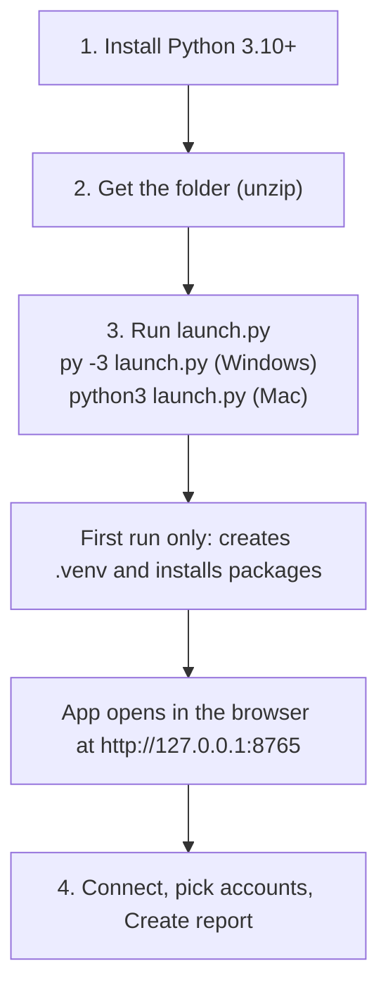

# Setup and launch guide

Step-by-step instructions to install and start the Industry Market Account Health Report (V3) on **Windows** and on **macOS**. The app runs on your own computer and opens in your browser. Nothing is installed system-wide: it creates a private Python environment in the `.venv` folder.

## What you need (both systems)

| Requirement | Detail |
|---|---|
| Python | Version **3.10 or newer** |
| Browser | Google Chrome or Microsoft Edge (Brave and Chromium also work on a Mac). Firefox cannot run the app, but you can open the finished Excel and HTML files in any browser. |
| IBM ID | To sign in to ISC and Gainsight in the browser window the app opens |
| Internet | For the first run (downloads four Python packages) and for the reports |

No passwords or tokens are stored in files. Sign-in happens in the browser window the app opens.



**Title:** Setup and launch flow. **Legend:** boxes are steps, arrows show the order. Step 3 differs by operating system.

---

## Windows

### 1. Install Python

1. Go to <https://www.python.org/downloads/> and download the latest Python 3 installer (3.10 or newer).
2. Run the installer. On the **first screen tick "Add python.exe to PATH"**, then click *Install Now*.
3. Check it: open PowerShell and run `py -3 --version`. It should print `Python 3.10` or higher.

### 2. Get the app

Unzip `SalesforceHealthReportV3.zip` to a normal folder such as `C:\Users\<you>\SalesforceHealthReportV3`. Avoid running it from inside the zip file, a network drive or a OneDrive folder that is set to "online only".

### 3. Launch

Open PowerShell and run:

```powershell
cd C:\Users\<you>\SalesforceHealthReportV3
py -3 launch.py
```

You can also double-click **`launch.py`** if Windows opens `.py` files with Python (the python.org installer sets this up).

- First run: the window says *First run: setting up*. This takes about a minute.
- Your browser opens the app. Keep the window open while you use the app. Close it or press Ctrl+C to stop the app.

If Windows SmartScreen says "Windows protected your PC", click *More info*, then *Run anyway*.

**Optional: start it from a page with one click.** Double-click `launcher\register_link.cmd` once, then open `launcher\Health report launcher.html` and click *Start the app*; the app opens in your browser. See *Start it from a launcher page* in `README.md`. Your browser may ask permission, and managed computers may block it. If so, use `py -3 launch.py`.

### Manual setup (only if launch.py fails)

```powershell
cd C:\Users\<you>\SalesforceHealthReportV3
py -3 -m venv .venv
.\.venv\Scripts\python.exe -m pip install -r requirements.txt
.\.venv\Scripts\python.exe app.py
```

---

## macOS

### 1. Install Python 3.10 or newer

macOS and the Xcode Command Line Tools (`xcode-select --install`) include **Python 3.9, which is too old**. Install a newer one with either option:

**Option A: Homebrew (recommended)**

```bash
# Install Homebrew first if you do not have it: https://brew.sh
brew install python@3.12
```

**Option B: python.org installer**

1. Download the macOS installer from <https://www.python.org/downloads/macos/> and run it.
2. Open Finder, go to **Applications > Python 3.x** and double-click **`Install Certificates.command`** once. Without this step, the package download in the first run can fail with an SSL certificate error.

Check it in Terminal: `python3.12 --version` (or `python3 --version`). It should print 3.10 or higher.

### 2. Get the app

Unzip `SalesforceHealthReportV3.zip` (double-click it in Finder). Put the folder somewhere in your home folder, for example `~/SalesforceHealthReportV3`.

### 3. Launch

macOS does not run `.py` files by double-click, so start it from Terminal:

```bash
cd ~/SalesforceHealthReportV3
python3 launch.py
```

If `python3` is Apple's Python 3.9, `launch.py` looks for a newer one (Homebrew or python.org) and uses it to build `.venv`. If it finds none, it tells you what to install.

- First run: it says *First run: setting up* and takes about a minute.
- Your browser opens the app. Keep the Terminal window open while you use the app. Press **Ctrl+C** or close the window to stop it.
- Downloaded files are quarantined by macOS. `launch.py` clears the quarantine flag on the app folder. If macOS still blocks Python from running the file, run `xattr -dr com.apple.quarantine .` in the app folder once.

### Manual setup (only if launch.py fails)

```bash
cd ~/SalesforceHealthReportV3
python3.12 -m venv .venv
.venv/bin/python -m pip install -r requirements.txt
.venv/bin/python app.py
```

Replace `python3.12` with the version you installed.

---

## Optional configuration (`.env`)

The app works without a `.env` file. To change a setting, copy `.env.example` to `.env` and edit it.

| Setting | Use it when | Example |
|---|---|---|
| `APP_PORT` | Port 8765 is already used by another program | `APP_PORT=8800` |
| `BROWSER_PATH` | The app cannot find your browser | Windows: `C:\Program Files\Google\Chrome\Application\chrome.exe`<br/>Mac: `/Applications/Google Chrome.app/Contents/MacOS/Google Chrome` |
| `ACCOUNTS_FILE` | You want a different account list | `ACCOUNTS_FILE=my_accounts.json` |
| `ISC_OPP_REPORT_URL` | You want to preset the opportunities report link | A report URL from ISC |

Copy command: Windows `copy .env.example .env`, Mac `cp .env.example .env`.

## First use

1. **Connect tab.** Click *Sign in to ISC* and finish IBM sign-in in the window that opens. Then click *Connect Gainsight*.
2. **Accounts tab.** Tick the accounts you want, or click *Select all*.
3. **Create report tab.** Choose the sections, then click *Create report*. The dashboard opens and the Excel file downloads. Tick *Use sample data* first if you want to see the layout without signing in.
4. **What you get.** Opportunities for the current and next quarter, current-quarter deployments (all dates if you tick the option) with dollar amounts and a link to each record in Salesforce, and Gainsight support tickets that are not closed (shown as Open, IBM is working or Awaiting customer feedback, any age), success plans with overdue and needs-update flags and the change in status since the last report, broken down by severity, state, client and product. Success plans, tickets, ELA rows and renewal forecast rows come from the account's main Gainsight company and from every other Gainsight company under the same coverage ID. Rows from another company start with its name in square brackets. Companies marked `non_us` in the account file (four Toyota companies today) are skipped and listed on the Notes sheet. MARRIOTT VACATION CLUB is a separate account that shares MARRIOTT's coverage ID.

Reports are saved in the `reports` folder and listed on the *Past reports* tab. Your sign-in is remembered in `.browser_profile`; never share that folder.

## Troubleshooting

| Symptom | System | Fix |
|---|---|---|
| "Python was not found" | Both | Install Python 3.10+ (see above). On Windows, tick *Add python.exe to PATH*, then close and reopen the window. |
| "Python 3.10 or newer was not found" | Mac | You only have Apple's Python 3.9. Run `brew install python@3.12` or use the python.org installer. |
| "cannot be opened because it is from an unidentified developer" | Mac | Run `xattr -dr com.apple.quarantine .` in the app folder, then `python3 launch.py` again. |
| `SSL: CERTIFICATE_VERIFY_FAILED` during setup | Mac (python.org) | Run **Install Certificates.command** in `/Applications/Python 3.x/`, delete the `.venv` folder, launch again. |
| Setup fails or the app crashes straight away after copying the folder from another computer | Both | Delete the `.venv` folder and launch again. A `.venv` made on Windows does not work on a Mac and the reverse. `launch.py` deletes a foreign `.venv` automatically; delete it by hand if that did not happen. |
| The sign-in window does not open / "browser not found" | Both | Install Chrome or Edge, or set `BROWSER_PATH` in `.env`. Close other windows that use the app's browser profile. |
| "Address already in use" / port 8765 | Both | Close the other copy of the app, or set `APP_PORT=8800` in `.env`. |
| Windows SmartScreen blocks the app | Windows | *More info*, then *Run anyway*. |
| Pip cannot download packages | Both | Check your internet or VPN/proxy. Delete `.venv` and launch again. |
| A sheet is empty, or Notes lists errors | Both | Your session may have expired (about 8 hours). Sign in again on the Connect tab. |
| Ticket Severity or Product columns are blank | Both | The Gainsight report may name the columns differently. The Notes sheet lists the real column names. |

## Updating or moving the app

- To update, replace the `.py` files and `static` folder with the new versions. Keep `.venv`, `settings.json` and `.env`.
- To share the app, zip the folder **without** `.venv`, `.browser_profile`, `reports`, `settings.json`, `.env` and `__pycache__`. See the *Sharing the app with others* section of [`README.md`](README.md).
